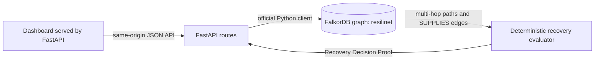

# ResiliNet AI

**Supply Chain Recovery Intelligence** — trace supplier disruptions across a connected supply graph, compare graph-backed alternatives, and show the evidence behind a deterministic recovery decision.

Hackathon: WeMakeDevs × FalkorDB Graph Hacks · **Track 01 — Agents That Act on Connected Data**

## Problem and intended use

Supply-chain teams need to understand which components, factories, and products depend on a disrupted supplier, then assess recorded alternatives against operational constraints. ResiliNet AI is a local prototype for procurement, operations, and supply-risk analysts to explore that workflow using a property graph. All included names, relationships, and capability values are synthetic demonstration data; they do not describe real organizations or validated procurement rules.

## What is implemented

- FastAPI serves the dashboard and API from one origin.
- The dashboard renders an interactive SVG supply-chain graph from the recovery API’s live graph-derived paths and alternative-supplier records; selecting a node highlights its direct relationships and the zoom control adjusts the view.
- FalkorDB is the source of truth for supplier impact paths and candidate-to-component compatibility.
- The recovery evaluator checks qualification, capacity, lead time, risk, and compatibility; it reports PASS, FAIL, or UNKNOWN with supporting reasons.
- The Recovery Decision Proof includes graph paths, missing information, rejection reasons, ranking method, and recommendations where the evidence supports one.
- Demo graph initialization uses additive, idempotent `MERGE` queries.
- This is a deterministic, graph-backed recovery analysis prototype, not an autonomous AI agent. It has no LLM, RAG, purchasing action, or production recovery engine; decisions follow documented demonstration rules.

## Architecture



| Component | Responsibility |
| --- | --- |
| `src/resilinet/main.py` | Serves the dashboard, validates requests, exposes health, initialization, impact, and recovery endpoints. Development docs are available at `/docs`; docs and OpenAPI routes are disabled when `APP_ENV=production`. |
| `src/resilinet/config.py` | Loads and validates environment-based FalkorDB settings. Local defaults use `localhost:6379` and graph `resilinet`. |
| `src/resilinet/graph.py` | Selects the graph using the official `falkordb` Python client and checks readiness with a read-only query. |
| `src/resilinet/supply_chain.py` | Defines the synthetic schema/data, fixed parameterized `UNWIND`/`MERGE` seed templates, and supplier impact traversal. |
| `src/resilinet/recovery.py` | Runs fixed parameterized graph queries, validates returned values, evaluates constraints, and deterministically ranks eligible suppliers. |
| `src/resilinet/static/index.html` | Responsive Sage Green × Warm White dashboard; API requests are relative URLs so the page and API share the FastAPI origin. |
| `docker-compose.yml` | Runs persistent local FalkorDB. An optional containerized API profile connects to the database by the Compose service hostname `falkordb`. |

FalkorDB is material to the product: removing it removes the multi-hop disruption evidence and the recorded supplier/component edges used to establish alternative compatibility. Python applies transparent business checks to those graph results; it does not invent paths or execute generated Cypher.

## Graph model

The graph uses directed property-graph relationships:

| Start | Relationship | End | Relevant properties |
| --- | --- | --- | --- |
| `Supplier` | `SUPPLIES` | `Component` | `qualification_status`, `capacity_units`, `lead_time_days`, `risk_score` |
| `Component` | `USED_BY` | `Factory` | `required_units` |
| `Factory` | `PRODUCES` | `Product` | synthetic source/scenario labels |

Demo nodes are labelled `synthetic=true`, `source=synthetic_demo`, and `scenario_id=resilinet-demo-v1`. Initialization only merges these demo records; it does not clear the graph or volume.

### Cypher used by the product

Supplier impact follows the actual directed dependency edges and returns the path members:

```cypher
MATCH (s:Supplier {id: $supplier_id})-[:SUPPLIES]->(c:Component)
      -[usage:USED_BY]->(f:Factory)-[:PRODUCES]->(p:Product)
RETURN s.id AS supplier_id, s.name AS supplier_name,
       c.id AS component_id, c.name AS component_name,
       f.id AS factory_id, f.name AS factory_name,
       p.id AS product_id, p.name AS product_name,
       usage.required_units AS required_units
ORDER BY p.id, c.id, f.id
```

Alternative suppliers are selected from recorded `SUPPLIES` edges for the affected component IDs; eligibility values are properties on those edges:

```cypher
MATCH (candidate:Supplier)-[supply:SUPPLIES]->(c:Component)
WHERE candidate.id <> $disrupted_supplier_id AND c.id IN $component_ids
RETURN candidate.id AS supplier_id, candidate.name AS supplier_name,
       c.id AS component_id, c.name AS component_name,
       supply.qualification_status AS qualification_status,
       supply.capacity_units AS capacity_units,
       supply.lead_time_days AS lead_time_days,
       supply.risk_score AS risk_score
ORDER BY c.id, candidate.id
```

The product uses fixed query templates and client parameters. FalkorDB’s official docs describe the property graph model, Python client, Cypher subset and parameter binding; the seed’s `UNWIND` and `MERGE` patterns are exercised against the pinned running database in integration tests. [Getting started](https://docs.falkordb.com/getting-started/) · [Official clients](https://docs.falkordb.com/getting-started/clients) · [Cypher reference](https://docs.falkordb.com/cypher) · [Data types](https://docs.falkordb.com/datatypes) · [Operations](https://docs.falkordb.com/operations) · [FalkorDB Browser](https://docs.falkordb.com/browser).

## Recovery evaluation and proof

For each disrupted component, demand is summed once per affected factory from the graph’s `USED_BY.required_units`. Alternative capacity is compared to that demand. A candidate must have a matching graph edge and exact `QUALIFIED` status, and must pass the demonstration maximum lead time (30 days) and risk score (0.7 on a 0–1 scale). Missing or malformed mandatory values are UNKNOWN and do not pass. A definite failed check rejects the candidate.

The demonstration score is `100 - lead_time_days - (10 × risk_score)`. Higher scores rank first; ties use ascending supplier ID. These thresholds and scores are illustrative, not validated industry standards. If missing evidence prevents choosing an eligible alternative, the outcome is `INSUFFICIENT_EVIDENCE`; if all available alternatives fail, it is `NO_VIABLE_ALTERNATIVE`. Unknown IDs return `UNKNOWN_SUPPLIER`.

## Local setup and run (Windows PowerShell)

Requirements: Docker Desktop with engine running and Python 3.12 or newer. Run commands from the project directory. The existing `.venv` can be reused.

```powershell
if (!(Test-Path .venv)) { py -3.12 -m venv .venv }
if (!(Test-Path .env)) { Copy-Item .env.example .env }
```

For a fresh environment, install the project-local dependencies (this does not install them globally):

```powershell
.\.venv\Scripts\python.exe -m pip install -e ".[dev]"
```

Start or check FalkorDB. The pinned official image is `falkordb/falkordb:v4.22.0`; host port 6379 is bound to loopback and the named volume persists data.

```powershell
docker compose up -d falkordb
docker compose ps
docker compose exec falkordb redis-cli ping
```

Start the API in another terminal. The Windows-host process uses `localhost` from `.env`/settings, while the optional Compose API uses the `falkordb` service hostname.

```powershell
.\.venv\Scripts\python.exe -m uvicorn resilinet.main:app --app-dir src --reload --host 127.0.0.1 --port 8000
```

Open [http://127.0.0.1:8000/](http://127.0.0.1:8000/). Do not open `src/resilinet/static/index.html` directly from File Explorer: API calls require a same-origin FastAPI page. If opened as a file, the dashboard now shows a link to the served page and disables API actions. Check readiness at [http://127.0.0.1:8000/health](http://127.0.0.1:8000/health). `{"status":"ok","graph":"connected"}` means the configured graph answered the readiness query.

### Optional containerized API

The API container is behind the `containerized-api` profile so ordinary local development remains unchanged. Stop the host Uvicorn process with Ctrl+C before binding its default port 8000 from Docker. Then run:

```powershell
docker compose --profile containerized-api up -d --build
docker compose --profile containerized-api ps
docker compose --profile containerized-api logs api
```

Inside Compose, the API uses `FALKORDB_HOST=falkordb`; the host-published API and FalkorDB ports are loopback-only. The containerized API was built and verified on `127.0.0.1:8000`, including health, synthetic graph initialization, impact analysis, and recovery requests. To use another host API port, set `$env:API_PORT='8001'` before `up`; the API still listens on port 8000 inside Compose.

Stop services without deleting data:

```powershell
docker compose --profile containerized-api stop api falkordb
```

Do not use `docker compose down -v` for this project; it deletes the persistent data volume.

## API examples

Initialize synthetic records (repeatable):

```powershell
Invoke-RestMethod -Method Post -Uri 'http://127.0.0.1:8000/demo/initialize' `
  -ContentType 'application/json' -Body '{"confirm_synthetic":true}'
```

Trace supplier impact:

```powershell
Invoke-RestMethod -Uri 'http://127.0.0.1:8000/suppliers/SUP-001/impact'
```

Evaluate a recovery scenario:

```powershell
Invoke-RestMethod -Method Post -Uri 'http://127.0.0.1:8000/recovery/scenarios' `
  -ContentType 'application/json' -Body '{"disrupted_supplier_id":"SUP-001"}'
```

The response includes `outcome`, `affected_paths`, candidate `checks`, `rejection_reasons`, `missing_information`, `recommendations`, and the `ranking_method`. Invalid IDs return 422; graph unavailability returns a generic 503 without exposing connection details. `/docs` and `/openapi.json` are available in development. With `APP_ENV=production`, those documentation routes and the dashboard’s docs link are disabled. This is not authentication or authorization; do not expose the development service publicly.

## Tests

Use the project virtual environment. Unit tests use controlled graph fakes and need no running database:

```powershell
.\.venv\Scripts\python.exe -m pytest -q -m "not integration"
```

The opt-in integration suite uses the real configured FalkorDB, verifies connectivity, merges the demo twice to check idempotence, traverses supplier impact paths, and evaluates recovery from graph data. It never clears graph records or the volume:

```powershell
$env:RUN_FALKORDB_INTEGRATION = "1"
try { .\.venv\Scripts\python.exe -m pytest -q -m integration }
finally { Remove-Item Env:RUN_FALKORDB_INTEGRATION -ErrorAction SilentlyContinue }
```

The API service currently uses `127.0.0.1:8000` in the containerized setup, and FalkorDB is on loopback port 6379. The dashboard root and API requests share the same origin; no CORS exception is needed. See [the compliance audit](docs/competition-compliance.md) for verification and remaining submission requirements.

## Configuration and secret handling

Settings come from environment variables or the ignored local `.env`: `APP_ENV`, `FALKORDB_HOST`, `FALKORDB_PORT`, `FALKORDB_USERNAME`, `FALKORDB_PASSWORD`, and `FALKORDB_GRAPH`. `.env.example` contains only empty optional credential fields and safe local defaults. `.gitignore` keeps `.env`, virtual environments, caches, build outputs, and egg metadata out of Git while allowing `.env.example` to be committed. No real credentials are required by the local demo.

## Reproducible demo walkthrough

1. Start FalkorDB and the API using the local commands above; confirm `/health` is successful.
2. Open the dashboard at `http://127.0.0.1:8000/` and initialize the labelled synthetic demo graph.
3. Select disrupted supplier `SUP-001` and analyze. The app queries the real graph for Supplier → Component → Factory → Product dependency paths. Inspect the interactive graph, select nodes to highlight connections, and adjust zoom; the textual evidence paths remain available below it.
4. Compare the recorded alternatives. Show `SUP-002`’s passing qualification, capacity, lead-time, risk, and compatibility checks; point out that missing `SUP-003` fields remain UNKNOWN.
5. Review the Recovery Decision Proof and explain the ranking formula and tie-breaker.
6. In `/docs` or FalkorDB Browser, show the fixed Cypher path query. Explain that FalkorDB determines which entities and compatible alternatives exist; the recovery evaluator cannot recommend a supplier without those graph edges.

## Demo video script (about 2 minutes 40 seconds)

- **0:00–0:15 — Problem:** “When a supplier is disrupted, teams need to see which products depend on it and whether an alternative is supported by evidence.”
- **0:15–0:35 — Product:** Show the real dashboard and identify the synthetic-data badge and four-step workflow.
- **0:35–0:50 — Initialize:** Click **Initialize demo data** and show the API’s returned seed counts.
- **0:50–1:20 — Disruption:** Analyze `SUP-001`. Trace one real returned path from supplier through component and factory to product; show all affected products.
- **1:20–1:50 — Alternatives:** Compare candidate rows. Show `SUP-002` as eligible and `SUP-003` as UNKNOWN because its required values are missing.
- **1:50–2:20 — Proof:** Walk through the qualification, capacity, lead-time, risk, and graph-compatibility checks, then explain the ranking and missing-information section.
- **2:20–2:40 — Graph centrality:** Show the fixed Cypher query in `/docs` or FalkorDB Browser. State that graph relationships supply impact evidence and alternative compatibility; no mock response or generated Cypher is used.

Record this from the running application and real database. Do not use a static mockup or imply the synthetic values are real-world sourcing data.

## Submission readiness checklist

- [x] Existing application and graph workflow preserved; no database reset.
- [x] README documents setup, graph model, Cypher, architecture, limitations, and demo.
- [x] Complete local setup instructions verified; no live deployment is claimed.
- [x] Target track documented: **Track 01 — Agents That Act on Connected Data**.
- [x] Interactive graph visualization renders graph-derived paths and alternatives from the recovery API.
- [x] AI coding assistant usage disclosed below.
- [ ] Public source-code repository updated with the project — the GitHub repository exists; its initial commit is joined to local history, but the project commits have not been pushed.
- [ ] Demo video — script prepared; recording not yet created.
- [ ] Submission form — submit repository URL, video URL, and selected track before the hackathon deadline.

**AI coding assistant disclosure:** OpenAI Codex assisted with implementation, testing, and documentation. The project owner should review the source and is responsible for the final submission.

## Limitations

- All supplied graph records are synthetic and illustrative.
- Eligibility thresholds and ranking formula are demo rules, not validated procurement policy.
- There is no authentication, authorization, production deployment, external supplier data feed, LLM, or automatic recovery execution.
- Hiding API docs in production mode does not secure the API. Add a reviewed authentication and deployment design before any public exposure.
- Hackathon deadline supplied by the project owner: October 18, 2026, 11:59 PM IST.
