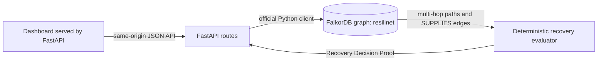

# ResiliNet AI

**Supply Chain Recovery Intelligence** — trace supplier disruptions across a connected supply graph, compare graph-backed alternatives, and show the evidence behind a deterministic recovery decision.

Hackathon: WeMakeDevs × FalkorDB Graph Hacks · **Track 01 — Agents That Act on Connected Data**

## Problem and intended use

Supply-chain teams need to understand which components, factories, and products depend on a disrupted supplier, then assess recorded alternatives against operational constraints. ResiliNet AI is a local prototype for procurement, operations, and supply-risk analysts to explore that workflow using a property graph. All included names, relationships, and capability values are synthetic demonstration data; they do not describe real organizations or validated procurement rules.

## What is implemented

- FastAPI serves the dashboard and API from one origin.
- The dashboard renders an interactive SVG supply-chain graph from the recovery API’s live graph-derived paths and alternative-supplier records; selecting a node highlights its direct relationships and the zoom control adjusts the view.
- FalkorDB is the source of truth for supplier impact paths and candidate-to-component compatibility.
- The recovery evaluator checks qualification, capacity, lead time, risk, and compatibility; it reports PASS, FAIL, or UNKNOWN with supporting reasons.
- The Recovery Decision Proof includes graph paths, missing information, rejection reasons, ranking method, and recommendations where the evidence supports one.
- Demo graph initialization uses additive, idempotent `MERGE` queries.
- This is a deterministic, graph-backed recovery analysis prototype, not an autonomous AI agent. It has no LLM, RAG, purchasing action, or production recovery engine; decisions follow documented demonstration rules.

## Architecture



| Component | Responsibility |
| --- | --- |
| `src/resilinet/main.py` | Serves the dashboard, validates requests, exposes health, initialization, impact, and recovery endpoints. Development docs are available at `/docs`; docs and OpenAPI routes are disabled when `APP_ENV=production`. |
| `src/resilinet/config.py` | Loads and validates environment-based FalkorDB settings. Local defaults use `localhost:6379` and graph `resilinet`. |
| `src/resilinet/graph.py` | Selects the graph using the official `falkordb` Python client and checks readiness with a read-only query. |
| `src/resilinet/supply_chain.py` | Defines the synthetic schema/data, fixed parameterized `UNWIND`/`MERGE` seed templates, and supplier impact traversal. |
| `src/resilinet/recovery.py` | Runs fixed parameterized graph queries, validates returned values, evaluates constraints, and deterministically ranks eligible suppliers. |
| `src/resilinet/static/index.html` | Responsive Sage Green × Warm White dashboard; API requests are relative URLs so the page and API share the FastAPI origin. |
| `docker-compose.yml` | Runs persistent local FalkorDB. An optional containerized API profile connects to the database by the Compose service hostname `falkordb`. |

FalkorDB is material to the product: removing it removes the multi-hop disruption evidence and the recorded supplier/component edges used to establish alternative compatibility. Python applies transparent business checks to those graph results; it does not invent paths or execute generated Cypher.

## Graph model

The graph uses directed property-graph relationships:

| Start | Relationship | End | Relevant properties |
| --- | --- | --- | --- |
| `Supplier` | `SUPPLIES` | `Component` | `qualification_status`, `capacity_units`, `lead_time_days`, `risk_score` |
| `Component` | `USED_BY` | `Factory` | `required_units` |
| `Factory` | `PRODUCES` | `Product` | synthetic source/scenario labels |

Demo nodes are labelled `synthetic=true`, `source=synthetic_demo`, and `scenario_id=resilinet-demo-v1`. Initialization only merges these demo records; it does not clear the graph or volume.

### Cypher used by the product

Supplier impact follows the actual directed dependency edges and returns the path members:

```cypher
MATCH (s:Supplier {id: $supplier_id})-[:SUPPLIES]->(c:Component)
      -[usage:USED_BY]->(f:Factory)-[:PRODUCES]->(p:Product)
RETURN s.id AS supplier_id, s.name AS supplier_name,
       c.id AS component_id, c.name AS component_name,
       f.id AS factory_id, f.name AS factory_name,
       p.id AS product_id, p.name AS product_name,
       usage.required_units AS required_units
ORDER BY p.id, c.id, f.id
```

Alternative suppliers are selected from recorded `SUPPLIES` edges for the affected component IDs; eligibility values are properties on those edges:

```cypher
MATCH (candidate:Supplier)-[supply:SUPPLIES]->(c:Component)
WHERE candidate.id <> $disrupted_supplier_id AND c.id IN $component_ids
RETURN candidate.id AS supplier_id, candidate.name AS supplier_name,
       c.id AS component_id, c.name AS component_name,
       supply.qualification_status AS qualification_status,
       supply.capacity_units AS capacity_units,
       supply.lead_time_days AS lead_time_days,
       supply.risk_score AS risk_score
ORDER BY c.id, candidate.id
```

The product uses fixed query templates and client parameters. FalkorDB’s official docs describe the property graph model, Python client, Cypher subset and parameter binding; the seed’s `UNWIND` and `MERGE` patterns are exercised against the pinned running database in integration tests. [Getting started](https://docs.falkordb.com/getting-started/) · [Official clients](https://docs.falkordb.com/getting-started/clients) · [Cypher reference](https://docs.falkordb.com/cypher) · [Data types](https://docs.falkordb.com/datatypes) · [Operations](https://docs.falkordb.com/operations) · [FalkorDB Browser](https://docs.falkordb.com/browser).

## Recovery evaluation and proof

For each disrupted component, demand is summed once per affected factory from the graph’s `USED_BY.required_units`. Alternative capacity is compared to that demand. A candidate must have a matching graph edge and exact `QUALIFIED` status, and must pass the demonstration maximum lead time (30 days) and risk score (0.7 on a 0–1 scale). Missing or malformed mandatory values are UNKNOWN and do not pass. A definite failed check rejects the candidate.

The demonstration score is `100 - lead_time_days - (10 × risk_score)`. Higher scores rank first; ties use ascending supplier ID. These thresholds and scores are illustrative, not validated industry standards. If missing evidence prevents choosing an eligible alternative, the outcome is `INSUFFICIENT_EVIDENCE`; if all available alternatives fail, it is `NO_VIABLE_ALTERNATIVE`. Unknown IDs return `UNKNOWN_SUPPLIER`.


## How to Run Locally

Requirements: Python and Docker Desktop.

Start FalkorDB: docker compose up -d falkordb

Start the API using the project's virtual environment.

Open http://127.0.0.1:8000/

Check http://127.0.0.1:8000/health

## Key Features

Graph-based supplier impact analysis

Interactive supply-chain relationship visualization

Alternative supplier evaluation

Recovery decision proof with PASS, FAIL, and UNKNOWN checks

Synthetic demo data and deterministic evaluation
## Tests

Use the project virtual environment. Unit tests use controlled graph fakes and need no running database:

```powershell
.\.venv\Scripts\python.exe -m pytest -q -m "not integration"
```

The opt-in integration suite uses the real configured FalkorDB, verifies connectivity, merges the demo twice to check idempotence, traverses supplier impact paths, and evaluates recovery from graph data. It never clears graph records or the volume:

```powershell
$env:RUN_FALKORDB_INTEGRATION = "1"
try { .\.venv\Scripts\python.exe -m pytest -q -m integration }
finally { Remove-Item Env:RUN_FALKORDB_INTEGRATION -ErrorAction SilentlyContinue }
```


## Reproducible demo walkthrough

1. Start FalkorDB and the API using the local commands above; confirm `/health` is successful.
2. Open the dashboard at `http://127.0.0.1:8000/` and initialize the labelled synthetic demo graph.
3. Select disrupted supplier `SUP-001` and analyze. The app queries the real graph for Supplier → Component → Factory → Product dependency paths. Inspect the interactive graph, select nodes to highlight connections, and adjust zoom; the textual evidence paths remain available below it.
4. Compare the recorded alternatives. Show `SUP-002`’s passing qualification, capacity, lead-time, risk, and compatibility checks; point out that missing `SUP-003` fields remain UNKNOWN.
5. Review the Recovery Decision Proof and explain the ranking formula and tie-breaker.


## Limitations

- All supplied graph records are synthetic and illustrative.
- Eligibility thresholds and ranking formula are demo rules, not validated procurement policy.

## AI-Assistance Disclosure

OpenAI Codex assisted with implementation, testing, and documentation. The project owner is responsible for reviewing and understanding the submitted code.
